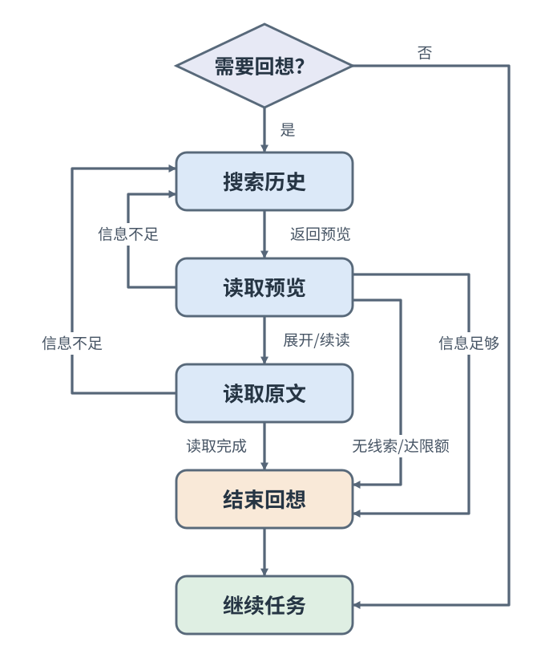
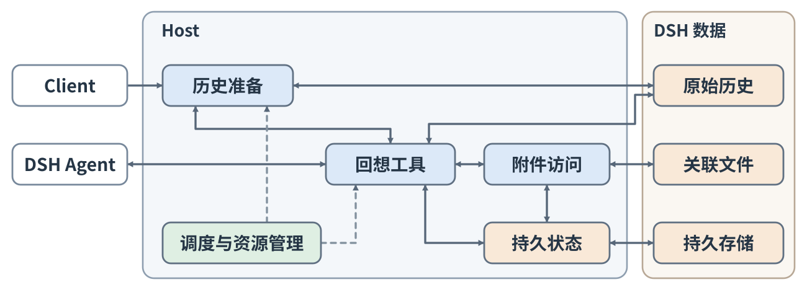

# dsh-recollection

简体中文 | [English](README_en.md)

[快速开始](#快速开始) | [工作原理](#工作原理) | [评测结果](#评测结果) | [注意事项](#注意事项) | [License](#license)

**让 AI 拥有「无限」记忆——对话再长，AI 也能想起。**

为 DeepSeek Harness 带来主动回想能力。即使上下文压缩让 AI 遗忘了先前的内容，它也能自主回想，从原始历史中找回所需信息。

- **自主回想**：AI 自主判断何时需要回顾历史，主动找回缺失的背景与细节，让回想自然融入对话与工作。
- **原文追溯**：回到原始记录，找回曾经的约定、关键细节和决策依据，还原事情的来龙去脉。
- **按需取回**：先找到线索，再按需展开细节。从长历史中逐步取回所需信息，减少不必要的上下文占用。

## 快速开始

通过 `dsh` 安装 `dsh-recollection`：

```sh
dsh plugin --profile web add dsh-recollection
```

更新到最新版本：

```sh
dsh plugin --profile web update dsh-recollection@latest
```

或从 GitHub Release 安装：

```sh
dsh plugin --profile web add "https://github.com/cqxsg/dsh-recollection/releases/latest/download/dsh-recollection.tgz"
```

安装或更新完成后，重新启动 DSH 即可使用。插件默认启用，AI 会在需要时自主回想。

## 工作原理

上下文压缩会将部分对话原文从模型可见的上下文移出，导致细节丢失。针对这一问题，`dsh-recollection` 为 AI 提供重新访问当前会话原始历史的能力，让它能够找回所需信息，实现按需回想。

`dsh-recollection` 提供两个回想工具。需要回顾历史时，AI 先通过 `recall_search` 查找相关记录，获得原文片段和来源信息；如果还需要更多细节，再通过 `recall_read` 展开原文与前后讨论。

### 运行流程

<p align="center">
  
</p>

### 总体架构

插件由运行在 DSH Web 界面的 Client 和运行在 DSH 宿主侧的 Host 组成。Client 上报当前会话与页面状态，Host 负责历史准备、搜索读取及状态和资源管理。



各模块的实现、数据流转与项目目录说明，详见[架构文档](docs/architecture.md)。

## 评测结果

### 测试方法

回想测试需要足够长的上下文，让 DSH 自然触发压缩。为此，`dsh-recollection` 基于 [SWE-Together](https://github.com/Togetherbench/SWE-Together) 构建多轮会话测试，在对话中通过方案选择、后续修订等方式引入约定及其变化理由，为后续的信息缺口构建提供基础。测试中将上下文压缩的触发阈值降低至 100,000 token，并保留最近 20,000 token 的内容，使多轮会话更容易触发上下文压缩。

会话结束后，复制同一份会话状态，分别在关闭和开启回想的两个分支中接续。两组继承相同的原始历史、压缩状态与工作区，使用相同的模型配置回答同一个历史问题，再按预先制定的评分标准对照结果。

### 数据集

配套数据集包含完整会话历史、压缩记录、测试问题、评分标准及对照回答，并配有数据构建与回想评测脚本。数据集仓库仍在整理中，将于后续发布。

### 回想效果

评测数据集目前包含 10 个用例，每个用例根据具体历史设置 6 个评分点，主要覆盖以下四个维度：

| 评估维度 | 评估内容 |
|---|---|
| 历史细节 | 能否准确找回先前的名称、参数、对应关系及操作顺序 |
| 决策依据 | 能否还原当时作出选择的具体理由与约束条件 |
| 方案演变 | 能否区分前后方案，说明修改原因，以及哪些要求被替换或保留 |
| 来源、证据与事实边界 | 能否区分用户提供的背景、AI 的实现选择和实际验证结果，准确判断原记录能证明什么、不能证明什么，避免补造历史 |

| 评定结果 | 关闭回想 | 开启回想 |
|---|---:|---:|
| 完整满足 | 16.7%（10/60） | 88.3%（53/60） |
| 部分满足 | 53.3%（32/60） | 10.0%（6/60） |
| 缺失 | 15.0%（9/60） | 0.0%（0/60） |
| 与历史矛盾 | 15.0%（9/60） | 1.7%（1/60） |

### 性能表现

测试使用 10,000 条合成记录，平均正文约 2 KB。作为参照，当前用于评估回想效果的数据集中，记录的平均正文为 2.24 KB。

| 指标 | 平均值 | P50 | P95 |
|---|---:|---:|---:|
| 历史准备时间 | 7.96 秒 | 7.75 秒 | 8.92 秒 |
| 搜索延迟 | 2.86 秒 | 2.82 秒 | 3.22 秒 |

## 注意事项

- **DSH 兼容性** — 当前适配 `@deepseek-ai/dsh 0.2.1-rc.4`，已在该版本完成验证。
- **Node.js** — 要求 `24.14.0` 及以上版本，目前已在 `24.14.0` 上验证。
- **运行平台** — 当前支持 Windows x64，使用 DSH Web 界面。
- **回想范围** — 当前支持本会话内的回想，跨会话回想已列入开发计划。
- **spill 文件保留** — DSH 会将超长工具输出保存为 spill 文件。为保留后续回想所需的完整输出，`dsh-recollection` 默认通过配置让 DSH 将新生成的 spill 文件保存到 DSH 数据目录下的 `spills` 目录，并关闭自动清理。此设置不会迁移已有的 spill 文件，也无法恢复已经丢失的文件。

### 测试环境

- **运行环境**：Windows x64、Node.js 24.14.0、DSH 0.2.1-rc.4
- **硬件**：AMD Ryzen 7 5800H、16 GB 内存
- **模型**：`deepseek-v4.1-flash-1017`，推理档位 `high`

## License

[Apache-2.0](https://www.apache.org/licenses/LICENSE-2.0)
