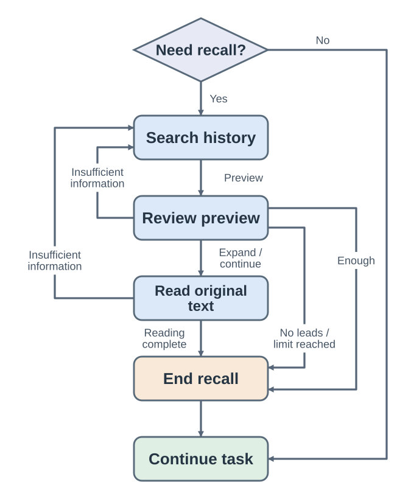
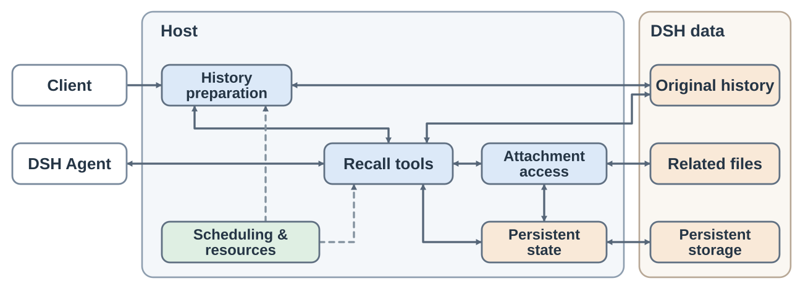

# dsh-recollection

[简体中文](https://github.com/cqxsg/dsh-recollection/blob/main/README.md) | English

[Quick start](#quick-start) | [How it works](#how-it-works) | [Evaluation results](#evaluation-results) | [Notes](#notes) | [License](#license)

**Let AI recall every word you've said.**

Proactive recall for DeepSeek Harness. Even when context compaction causes AI to lose earlier details, it can retrieve the information it needs from the original history on its own.

`dsh-recollection` does not rely on prior long-term memory extraction or consolidation, nor does it require deciding in advance which parts of the conversation are worth remembering. It focuses on helping AI revisit original records whenever needed, either on its own or alongside other long-term memory systems.

- **Autonomous recall**: AI decides when to revisit history and retrieves missing context and details, making recall a natural part of conversations and work.
- **Original records**: Revisit earlier agreements, key details, and the rationale behind decisions in their original conversational context.
- **On-demand retrieval**: Find relevant records first, then expand only what you need to keep context usage low.
- **`/recall` command**: Explicitly ask the model to recall history. Use `/recall <what you want to recall>` to specify a target.

## Quick start

Install `dsh-recollection` using `dsh`:

```sh
# dsh desktop
dsh plugin --profile desktop add dsh-recollection

# dsh web
dsh plugin --profile web add dsh-recollection
```

Update to the latest version:

```sh
# dsh desktop
dsh plugin --profile desktop update dsh-recollection@latest

# dsh web
dsh plugin --profile web update dsh-recollection@latest
```

Or install from GitHub Release:

```sh
# dsh desktop
dsh plugin --profile desktop add "https://github.com/cqxsg/dsh-recollection/releases/latest/download/dsh-recollection.tgz"

# dsh web
dsh plugin --profile web add "https://github.com/cqxsg/dsh-recollection/releases/latest/download/dsh-recollection.tgz"
```

After installing or updating, enable the plugin to start using it. No restart is needed when hot reload is active. AI will recall information when needed.

## How it works

Context compaction removes some of the original conversation from the model's visible context, which can cause details to be lost. `dsh-recollection` lets AI revisit the original history of the current session and retrieve the information it needs on demand.

`dsh-recollection` provides two recall tools. When AI needs to revisit history, it first uses `recall_search` to find relevant records and obtain original excerpts with source information. If it needs more detail, it uses `recall_read` to expand the original text and surrounding discussion.

### How it relates to long-term memory

Long-term memory systems typically distill and organize past information to retain facts, preferences, and experiences that may be useful later. `dsh-recollection` takes a different approach: rather than deciding in advance what is worth remembering, it lets AI revisit original session history when needed.

The two approaches can work together and complement each other. With `dsh-recollection`, AI can revisit original records on its own without a long-term memory system. When used alongside one, the plugin lets AI trace information back to its source and recover details from the original conversation. In turn, information retained in long-term memory can give AI clues for locating relevant records more precisely with `dsh-recollection`.

### Runtime flow

<p align="center">
  
</p>

### Overall architecture

The plugin consists of a Client running in the DSH Web interface and a Host running on the DSH host side. The Client reports the current session and page state; the Host handles history preparation, search and reading, and state and resource management.



For module implementations, data flow, and project directories, see the [architecture document](https://github.com/cqxsg/dsh-recollection/blob/main/docs/architecture_en.md).

## Evaluation results

### Test methodology

To evaluate recall after context compaction, we construct extended, multi-turn conversations based on [SWE-Together](https://github.com/Togetherbench/SWE-Together). These scenarios introduce decisions, constraints, subsequent revisions, and the reasons behind those revisions, creating historical details that may be lost after compaction.

We use DSH's native compaction mechanism, with the compaction threshold set to 100,000 tokens and the most recent 20,000 tokens retained.

After a conversation ends, we fork the same session state into two continuations, with recall disabled in one and enabled in the other. Both inherit the same original history, compaction state, and workspace. They answer the same question about the history using identical model settings; **the only difference in setup is whether the recall component is enabled**. The test question **does not instruct the model to call recall tools, leaving that choice to the model**. Answers are then compared against a predefined rubric.

### Dataset

The accompanying dataset includes complete conversation histories, compaction records, test questions, scoring rubrics, and paired answers, along with scripts for dataset construction and recall evaluation. The dataset repository is still being organized and will be released later.

### Recall effectiveness

The evaluation dataset currently contains 30 test cases, each with 6 rubric items tailored to its history, primarily covering these four dimensions:

| Evaluation dimension | What is assessed |
|---|---|
| Historical details | Accurate retrieval of earlier names, parameters, relationships, and operation sequences |
| Decision rationale | Recovery of the specific reasons and constraints behind earlier choices |
| Plan evolution | Distinguishing earlier and later plans, explaining revisions, and identifying requirements that were replaced or retained |
| Source attribution and evidence limits | Distinguishing user-provided background, AI implementation choices, and actual verification results; correctly identifying what the original records can and cannot establish without inventing history |

| Assessment result | Recall disabled | Recall enabled |
|---|---:|---:|
| Fully satisfied | 27.8% (50/180) | 83.9% (151/180) |
| Partially satisfied | 30.0% (54/180) | 8.9% (16/180) |
| Missing | 3.3% (6/180) | 0.0% (0/180) |
| Contradicts the history | 38.9% (70/180) | 7.2% (13/180) |

With recall enabled, **93.3% of test cases used recall tools**. The mean number of calls per case was **5.2** for `recall_search` and **4.0** for `recall_read`.

### Token consumption

| Mean per case | Recall disabled | Recall enabled | Change |
|---|---:|---:|---:|
| Input tokens (cache hit) | 812,420.27 | 812,010.67 | −409.60 (−0.05%) |
| Input tokens (cache miss) | 53,530.57 | 69,327.77 | +15,797.20 (+29.51%) |
| Output tokens | 14,143.53 | 9,517.60 | −4,625.93 (−32.71%) |
| Terminal calls | 13.77 | 2.07 | −11.70 (−84.99%) |

With recall enabled, the model retrieves relevant evidence from historical records, reducing the need to inspect code and rerun experiments. Terminal calls decrease substantially.

### Performance

The test uses synthetic records with an average text body of approximately 2 KB. For reference, records in the recall evaluation dataset have an average text body of approximately 2.24 KB. The five test scales contain 128, 512, 2,048, 5,000, and 10,000 records, respectively.

**History preparation time (seconds)**

| Records | Mean | P50 | P95 |
|---|---:|---:|---:|
| 128 | 0.041 | 0.043 | 0.053 |
| 512 | 0.081 | 0.078 | 0.090 |
| 2,048 | 0.561 | 0.553 | 0.641 |
| 5,000 | 2.022 | 1.968 | 2.153 |
| 10,000 | 7.962 | 7.748 | 8.919 |

**Search latency (seconds)**

| Records | Mean | P50 | P95 |
|---|---:|---:|---:|
| 128 | 0.493 | 0.476 | 0.569 |
| 512 | 0.599 | 0.573 | 0.740 |
| 2,048 | 1.044 | 1.036 | 1.163 |
| 5,000 | 1.564 | 1.554 | 1.652 |
| 10,000 | 2.862 | 2.822 | 3.216 |

## Notes

- **DSH compatibility** — Supports `0.2.x` versions starting from `0.2.1-rc.1`.
- **Validated versions** — npm / Web validated from `0.2.1-rc.4` through `0.2.2-rc.3`; Desktop validated with `0.2.2-rc.3`. Validation of `0.2.2-alpha.2` was blocked by a host agent preset defect. Other versions have not been individually validated.
- **Node.js** — Requires `24.14.0` or later; validated with `24.14.0`.
- **Platform** — Windows x64.
- **Recall scope** — Recall currently covers the current session. Cross-session recall is planned.
- **Spill file retention** — DSH stores oversized tool outputs in spill files. To preserve complete outputs for later recall, `dsh-recollection` configures DSH by default to store new spill files in the `spills` directory under the DSH data directory and disable automatic cleanup. This does not move existing spill files or restore files that have already been lost.

### Evaluation environment

- **Runtime**: Windows x64, Node.js 24.14.0, DSH 0.2.1-rc.4
- **Hardware**: AMD Ryzen 7 5800H, 16 GB RAM
- **Model**: `deepseek-v4.1-flash-1017`, with reasoning effort set to `high`

## License

[Apache-2.0](https://www.apache.org/licenses/LICENSE-2.0)
