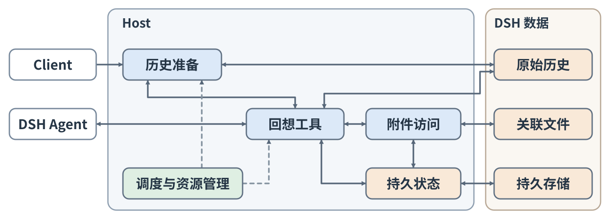
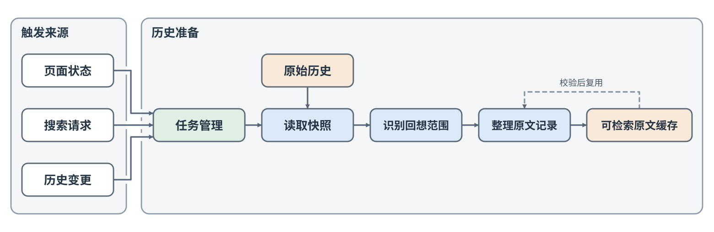
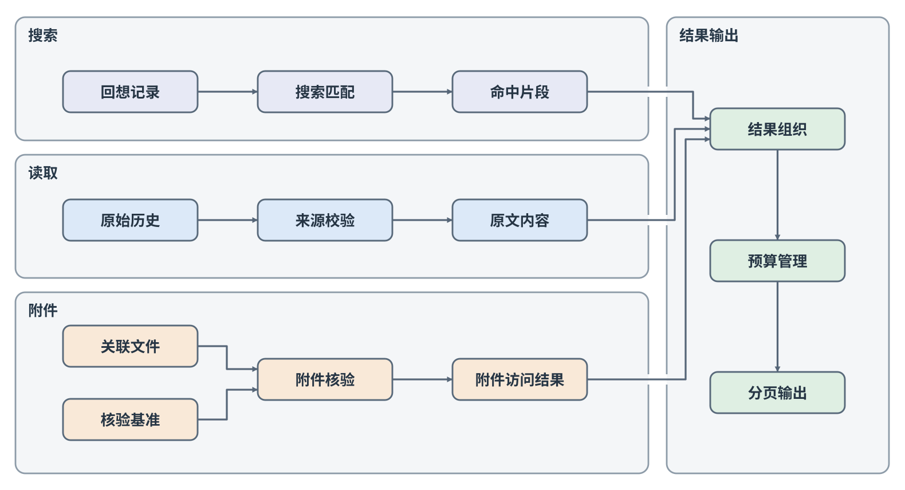
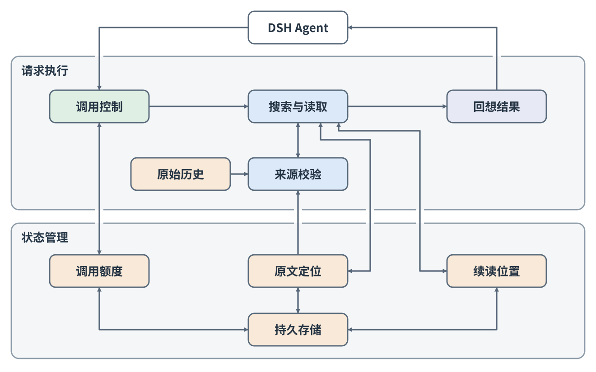
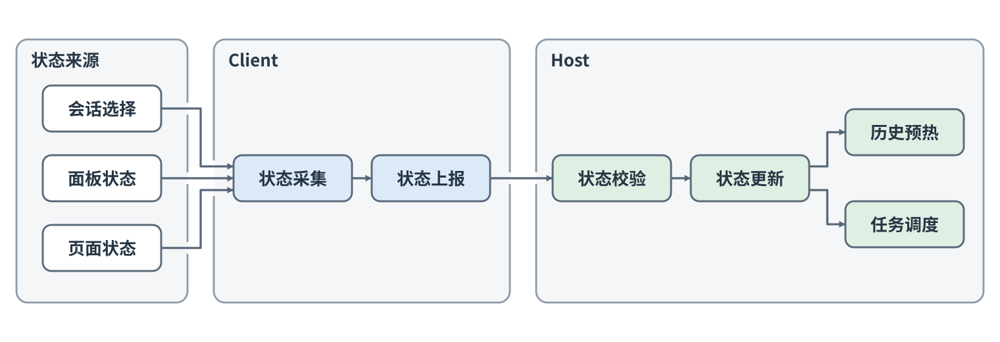
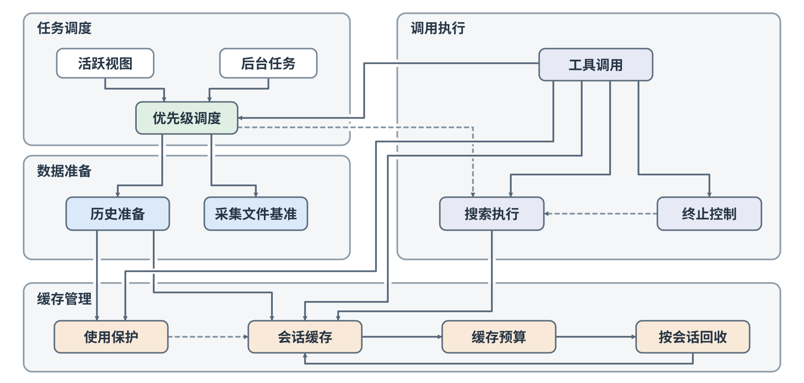

# dsh-recollection 架构设计

简体中文 | [English](architecture_en.md)

[架构概览](#架构概览) | [项目结构](#项目结构) | [模块设计](#模块设计)

## 架构概览

`dsh-recollection` 由运行在 DSH Web 界面中的 Client、宿主侧的 Host 和常驻 Rust worker 组成。Client 采集页面与会话状态，Host 对接 DSH 原始历史并协调回想工具、状态与资源，Rust worker 执行搜索匹配。AI 通过 `recall_search` 和 `recall_read` 按需查找与展开当前会话历史。

## 项目结构

下表列出主要源码与开发目录。

| 目录 | 职责 |
|---|---|
| `src/` | 插件入口与可选预热入口，分别位于 `index.ts` 和 `prewarm.ts` |
| `src/client/` | 页面与会话状态观察、状态上报及 Client 生命周期 |
| `src/shared/` | Host 与 Client 共用的通信协议、状态类型和时间常量 |
| `src/host/` | Host 服务组装、工具接入、协议与诊断入口 |
| `src/host/history/` | 原生历史访问、范围与来源解析、记录整理及历史准备 |
| `src/host/retrieval/` | 搜索与读取、匹配及 worker 接入、结果组织与输出 |
| `src/host/attachments/` | 附件访问与读取、版本核验、后台哈希采样及哈希账目 |
| `src/host/state/` | 页面状态、调用额度、游标与来源引用、持久化账目 |
| `src/host/runtime/` | 配置、调用控制、身份管理、调度及内存资源管理 |
| `native/worker/` | Rust 搜索 worker 源码及依赖锁文件 |
| `native/third-party/` | 固定的第三方来源、校验摘要及许可声明 |
| `test/` | 组件、集成、浏览器、恢复与打包测试，以及独立参考实现 |
| `scripts/build/` | 编译、Typert 合约生成、原生工具链准备与构建 |
| `scripts/dev/` | 隔离开发环境中的 DSH Web 启动入口 |
| `scripts/package/` | 安装包生成及包内容检查 |
| `scripts/setup/` | 开发工具安装 |
| `support/` | 开发、测试与评测共用的环境隔离、启动辅助及测试样例 |
| `benchmarks/` | 性能、容量与资源消耗测量 |

基于 SWE-Together 的长历史、数据构建与效果评测流程将随配套数据集仓库发布；该仓库目前仍在整理中。

## 模块设计

### 历史接入与准备

`dsh-recollection` 从 DSH 保存的原始会话历史中，提取退出上下文的原文，并整理成统一的回想记录。

Host 通过 DSH 的 `ctx.sessionQuery.observeSession` 接口，以 `projectionMode: 'none'` 获取原生事件快照。快照中的 `cursor` 标记本次处理的历史边界，后续范围识别与记录提取均以这一边界为准。

上下文范围的解析复用 DSH 的 `foldSurface` 函数，并传入 `ctx.sessions.messageProjections` 中注册的消息投影规则，解析历史中的消息追加、替换与卸载关系。插件根据解析结果中的替换记录和当前保留节点，结合 `image/offload` 事件，定位因上下文替换、工具结果裁剪或图像卸载而退出上下文的原始记录，并保留对应的移除原因。

提取原文时，插件通过 DSH 的 `isAppendSurfaceEvent` 识别原始消息来源，将相关内容整理为 `CanonicalRecord`。记录保留原文、角色 `role`、类型 `kind`，以及来源事件 `origin.seq`、轮次 `origin.turn` 和步骤 `origin.step`。工具调用与结果按照原生轮次、步骤及 `callId` 建立配对关系，文件和图像保留附件引用，为后续定位来源、展开前后讨论和查看相关资料提供依据。

历史准备由 `RecallPreparationService` 协调，支持后台预热和工具调用时的按需准备。同一会话的准备请求合并处理，原文分批提取并缓存。后续准备时，先校验来源与内容指纹，再复用校验通过的已有记录。

插件同时订阅 DSH 的 `session/event` 事件，跟踪历史变化。通过 `isReplacementSurfaceEvent` 识别上下文替换，并结合 `image/offload` 事件更新回想范围，补充准备新退出上下文的内容。

### 搜索与读取

`recall_search` 基于 **ripgrep** 的匹配组件实现，支持字面搜索和正则表达式搜索。插件将这些组件集成到常驻的 Rust worker 中，复用进程和已编译的搜索表达式，减少重复启动与编译的开销。搜索完成后，返回命中位置附近的原文预览及来源引用，供 AI 进一步展开。

`recall_read` 的读取范围基于 DSH 的原生会话结构设计。DSH 在历史中记录了对话轮次（`turn`）、执行步骤（`step`），以及工具调用与结果之间的关联。插件利用这些信息，提供三种展开层次：

| 读取范围 | 用途 |
|---|---|
| 单条记录（`record`） | 查看命中记录的原文细节 |
| 相邻上下文（`context`） | 结合前后记录理解指代、背景与讨论关系 |
| 所在轮次（`turn`） | 查看同一轮交互中的讨论与执行过程 |

读取按原始会话顺序组织内容，并将相关的工具调用与结果一起纳入范围，使 AI 能够沿着历史中的实际交互过程理解信息。

#### 文件版本核验

历史中的文件路径可能保持不变，内容却已经被修改。`dsh-recollection` 通过哈希校验判断文件内容是否变化：后台采集新记录所引用文件的内容哈希，将比对基准、采样时间与原始引用绑定；回想时重新计算并比对。对于 DSH 归档的文件附件，则使用附件标识中的内容哈希作为比对依据。

核验结果区分内容一致、内容变化和未核验，并提供相应的时间信息，让 AI 在使用资料前了解其版本关系。附件检查分别报告可访问状态与版本信息，并在可访问时提供访问路径。附件正文不会作为回想结果返回，查看附件内容需使用文件或图像工具。

#### 按上下文预算分页

长历史中的搜索结果和原文可能占用大量上下文。插件先通过搜索预览呈现线索，再按需展开原文，并以 token 预算控制每次返回的内容量，让 AI 可以在信息足够时停止取回。

分页使用 DSH 的 `estimateContent` 估算整页结果的 token 占用，将原文、来源和续读信息一起计入预算，并结合 DSH 的工具结果内联上限确定页大小。读取时优先保留完整记录及关联的工具交互，超长记录再分段返回。续读游标绑定本次固定的结果范围和读取位置，使后续页面能够接续此前进度。

原文与附件可按请求分别选择；附件仅在显式选择时访问。

### 结果与状态管理

搜索与读取采用统一的结果结构。返回的历史记录项包含文本及来源信息，包括角色、时间、轮次和相关工具信息。搜索预览保留连续的原文片段，并标明展示区间、前后省略情况和内容是否完整，为进一步展开提供依据。

在记录之外，结果还提供整次操作的执行状态，包括搜索是否完成、所选原文是否读完，以及已知的来源缺口。续读游标、剩余额度与可用操作也随结果返回，让 AI 能够区分当前展示的内容和仍待获取的部分，并据此安排后续回想。

#### 来源定位与校验

Host 从工具执行上下文中的 `exec.agent.session.id` 确定会话，通过 `ctx.sessionQuery.observeSession` 获取原始历史快照。快照的 `header` 提供会话身份与格式信息，事件序号 `seq` 定位原始事件；插件再结合原始消息 ID 和内容块位置生成记录标识，将这些定位信息与内容指纹绑定，保存为 `ref` 对应的来源映射。

后续读取时，Host 根据 `ref` 找到来源映射，重新访问原始历史，核对历史身份、事件位置和记录标识，并校验提取内容的指纹。这样，从搜索预览到原文展开，始终能够追溯到同一条原始记录。

#### 回想次数控制

连续搜索和反复展开历史会增加等待时间与上下文消耗。`dsh-recollection` 以一次用户交互为单位设置搜索、读取和翻页额度，控制一轮回想的历史探索规模。

调用账本根据 DSH 原生用户消息 ID 确定交互归属，并结合工具调用事件中的 `callId` 和事件序号识别每次调用。执行前登记调用与额度占用，结束后保存执行状态；已登记的同一次调用重放时沿用原有记账，避免重复执行和计数。

结果通过 `budget` 返回剩余额度，通过 `allowed_actions` 提供当前可执行的操作。AI 可以据此调整后续回想，调用控制也根据同一份账本执行额度限制。

来源引用、游标映射、调用账本和文件核验基准通过 DSH 的 `storageDomain` 持久保存。引用与游标在映射保存完成后随结果返回；当次搜索结果、固定读取范围和原文缓存则在内存中维护。

因此，Host 重启或缓存回收后，即使游标映射仍在，续读游标也可能失效。调用方可以重新搜索，或在来源引用仍能通过校验时重新发起读取。

### 会话感知与接入

为减少临时加载历史带来的延迟，`dsh-recollection` 识别页面当前选中的会话，并结合会话面板、页面可见性与焦点状态，提前安排历史准备，优先处理用户当前关注的会话。

为此，插件在 DSH Web 界面中引入 **Client**，负责采集和上报页面状态；运行在 DSH 宿主侧的 **Host** 接收这些信息，协调历史准备与任务调度。

Client 中的 `PageObserver` 从 DSH 的公开状态接口和浏览器事件中采集信息，整理为 `ViewState`：

| 字段 | 含义 |
|---|---|
| `sessionId` | 页面当前选中的会话；无法确定时为 `null` |
| `selection` | 会话选择状态：明确选中（`selected`）、未选中（`none`）或存在歧义（`ambiguous`） |
| `conversationVisible` | 界面是否正在显示会话面板 |
| `visible` | 浏览器页面是否可见 |
| `focused` | 页面是否获得焦点 |
| `closed` | 页面是否已离开或关闭 |

`PageObserver` 订阅会话与布局变化，并监听浏览器的可见性、焦点和页面生命周期事件。状态发生变化后，由 `PageReporter` 通过 RPC 同步给 Host；连续变化会合并为待上报的最新状态，避免堆积重复请求。

每个页面使用独立的 `pageId`，先通过 `openPage` 注册，获得 `hostEpoch` 和 `registrationId`，再通过 `reportView` 上报状态。Host 根据递增的 `sequence` 识别上报顺序并接受更新。Client 同时通过周期性心跳维持页面状态，连接恢复后重新注册，并在发送前重新采集当前状态。

Host 在会话选择明确、会话面板显示且页面未关闭时，可以启动历史准备；页面可见性与焦点进一步参与活跃视图判定，为调度提供依据。

实际回想时，Host 从工具执行上下文中的 `exec.agent.session.id` 获取会话标识，按需完成历史准备，并在该会话范围内执行搜索与读取。

### 调度与资源管理

历史准备、搜索和文件哈希采样会共同消耗计算、I/O 与缓存资源。`dsh-recollection` 根据用户当前关注的会话和实际调用需求安排任务，并通过分批执行、并发限制与统一缓存预算控制资源占用。

#### 任务优先级

调度器结合 Client 上报的活跃视图、工具调用的等待状态和任务类型分配优先级，优先服务当前关注的会话，并提高已有工具调用正在等待的历史准备任务的优先级。同级任务按入队顺序处理。

历史准备按批次推进，每个批次结束后重新评估优先级，使新到达的高优先级需求能够在后续批次中获得处理机会。文件哈希采样使用独立的执行通道，其 I/O 等待期间，历史准备仍可继续推进。

#### 并发与执行控制

搜索任务进入 Host 共享的 `MatchingPool`，由有限数量的常驻 Rust worker 执行。池内同时限制 worker 并发数、排队请求数量和待处理数据量，并根据任务优先级安排后续匹配，避免多个会话各自扩张搜索资源。

每次工具调用通过 `CallTimeline` 统一管理等待、执行和重试所消耗的时间，并接入 DSH 的取消信号。单次调用取消时，清理该调用对应的排队请求和执行资源。共享历史准备按自身生命周期管理，仍可为其他等待中的调用提供结果。

#### 缓存预算与回收

原文记录、搜索结果和读取范围统一纳入 `RecallMemoryBudget`，按缓存对象估算占用。多个模块引用同一个原文对象时，共享其正文计量，减少重复计算。

执行中的会话通过 `pin` 保留所需缓存，任务结束后释放保护。预算不足时，优先回收非当前会话中较久未使用的缓存，并按会话整体清理相关记录与结果状态。

