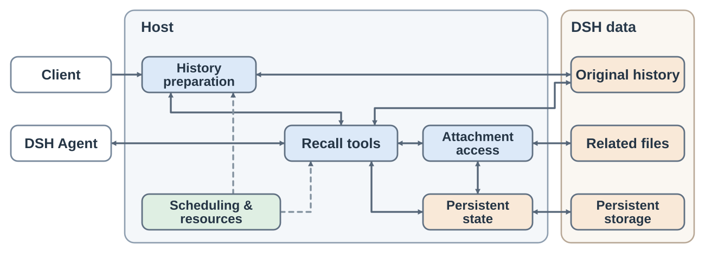
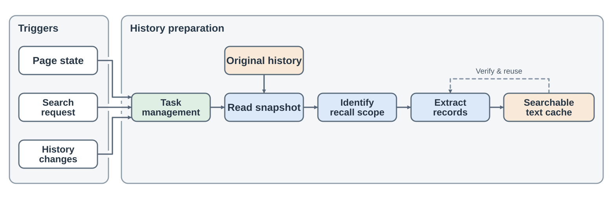
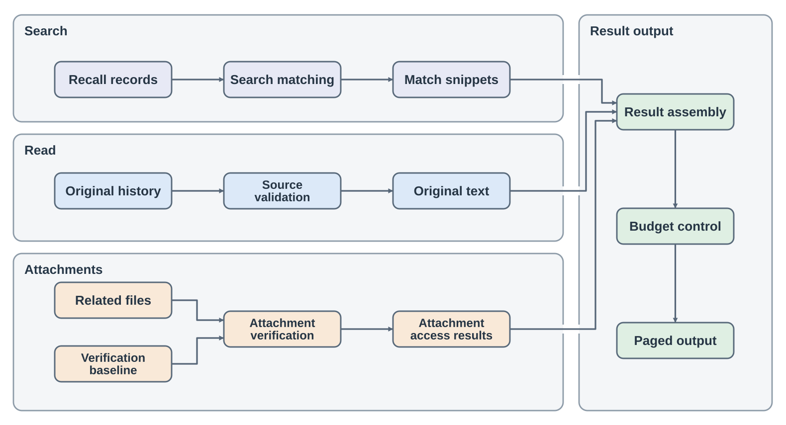
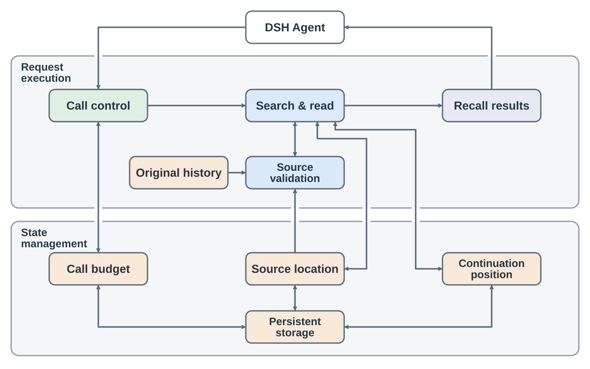
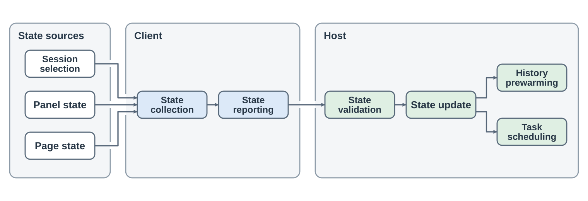
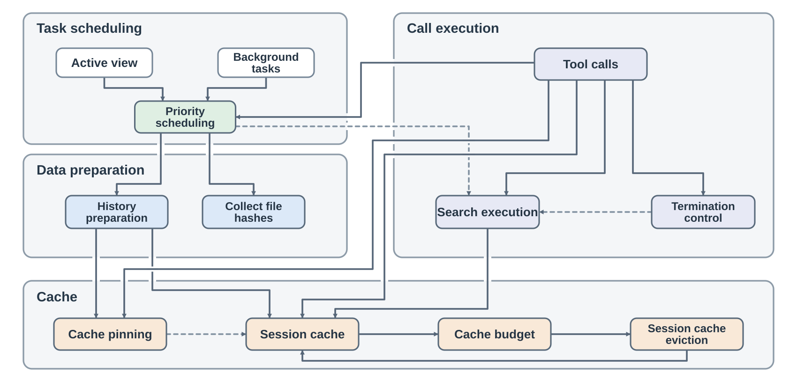

# dsh-recollection Architecture

[简体中文](architecture.md) | English

[Architecture overview](#architecture-overview) | [Project structure](#project-structure) | [Module design](#module-design)

## Architecture overview

`dsh-recollection` consists of a Client running in the DSH Web interface, a Host running on the DSH host side, and persistent Rust workers. The Client collects page and session state; the Host accesses the original DSH history and coordinates recall tools, state, and resources; the Rust workers perform search matching. AI uses `recall_search` and `recall_read` to find and expand the current session's history on demand.

## Project structure

The table below lists the main source and development directories.

| Directory | Responsibility |
|---|---|
| `src/` | Plugin entry point and optional prewarming entry point, in `index.ts` and `prewarm.ts` respectively |
| `src/client/` | Page and session state observation, state reporting, and the Client lifecycle |
| `src/shared/` | Communication protocols, state types, and timing constants shared by the Host and Client |
| `src/host/` | Host service assembly, tool integration, protocol handling, and diagnostics |
| `src/host/history/` | Native history access, scope and source resolution, record extraction, and history preparation |
| `src/host/retrieval/` | Search and reading, matching and worker integration, result assembly and output |
| `src/host/attachments/` | Attachment access and reading, version verification, background hash sampling, and hash records |
| `src/host/state/` | Page state, call budgets, cursors and source references, and persistent ledgers |
| `src/host/runtime/` | Configuration, call control, identity management, scheduling, and memory management |
| `native/worker/` | Rust search worker source and dependency lockfile |
| `native/third-party/` | Pinned third-party sources, verification digests, and license notices |
| `test/` | Component, integration, browser, recovery, and packaging tests, plus independent reference implementations |
| `scripts/build/` | Compilation, Typert contract generation, and native toolchain setup and builds |
| `scripts/dev/` | DSH Web launcher for isolated development environments |
| `scripts/package/` | Package creation and package content validation |
| `scripts/setup/` | Development tool installation |
| `support/` | Environment isolation, launch helpers, and fixtures shared by development, testing, and evaluation |
| `benchmarks/` | Performance, capacity, and resource usage measurements |

Long histories based on SWE-Together, dataset construction, and recall evaluation workflows will be published in the accompanying dataset repository, which is still being organized.

## Module design

### History access and preparation

`dsh-recollection` extracts original text that has left the model's context from the original session history stored by DSH, then converts it into a common recall record format.

The Host obtains a snapshot of native events through DSH's `ctx.sessionQuery.observeSession` interface with `projectionMode: 'none'`. The snapshot's `cursor` marks the history boundary for this preparation pass; both scope identification and record extraction use that boundary.

To determine the context scope, the plugin reuses DSH's `foldSurface` function with the message projection rules registered in `ctx.sessions.messageProjections`. This resolves message appends, replacements, and offloading in the history. Using the resulting replacement records and currently retained nodes, together with `image/offload` events, the plugin identifies original records removed from context by context replacement, tool-result pruning, or image offloading, and retains the reason for each removal.

When extracting original text, the plugin uses DSH's `isAppendSurfaceEvent` to identify the original message sources and converts the relevant content into `CanonicalRecord` objects. Each record retains the original text, `role`, `kind`, and source event `origin.seq`, turn `origin.turn`, and step `origin.step`. Tool calls and their results are paired using native turns, steps, and `callId`. Files and images retain attachment references, supporting later source lookup, expansion of the surrounding discussion, and access to related material.

`RecallPreparationService` coordinates history preparation, supporting both background prewarming and on-demand preparation during tool calls. Preparation requests for the same session are combined, and original text is extracted and cached in batches. Later preparation passes validate the sources and content fingerprints before reusing existing records that pass validation.

The plugin also subscribes to DSH's `session/event` events to track history changes. It identifies context replacements through `isReplacementSurfaceEvent` and combines them with `image/offload` events to update the recall scope and prepare content that has newly left the context.

### Search and read

`recall_search` uses the matching components of **ripgrep**, supporting both literal and regular expression searches. The plugin integrates these components into persistent Rust workers, reusing processes and compiled search expressions to reduce repeated startup and compilation costs. Search returns previews of the original text around each match, along with source references that AI can use to expand the results.

The reading scopes of `recall_read` follow DSH's native session structure. DSH records conversation turns (`turn`), execution steps (`step`), and the relationships between tool calls and results. The plugin uses this information to provide three levels of expansion:

| Reading scope | Purpose |
|---|---|
| Single record (`record`) | Inspect the original details of a matched record |
| Surrounding context (`context`) | Use nearby records to understand references, background, and relationships within the discussion |
| Containing turn (`turn`) | Review the discussion and execution within the same interaction |

Reading preserves the original session order and includes related tool calls and results in the scope, so AI can understand information in the context of the actual historical interaction.

#### File version verification

A file path in the history may remain unchanged even after its contents have been modified. `dsh-recollection` uses hashes to detect content changes: it collects content hashes for files referenced by new records in the background, binding the comparison baseline and sampling time to the original reference, then recomputes and compares hashes during recall. For file attachments archived by DSH, the content hash in the attachment identifier serves as the comparison baseline.

Verification distinguishes matching content, changed content, and unverified content, and provides the relevant timestamps so AI can understand the version relationship before using the material. Attachment checks report availability separately from version information and include an access path when available. Attachment contents are not included in recall results; separate file or image tools are used to inspect those contents.

#### Pagination within the context budget

Search results and original text from long histories can consume substantial context. The plugin first presents leads through search previews, then expands the original text on demand. A token budget controls the amount returned on each page, allowing AI to stop retrieving once it has enough information.

Pagination uses DSH's `estimateContent` to estimate token usage for the entire result page, counting original text, source information, and continuation information together. Page size also respects DSH's limit for inline tool results. Reading prioritizes complete records and related tool interactions, splitting oversized records into segments when necessary. Continuation cursors are bound to the fixed result scope and reading position for the operation, allowing later pages to continue from the previous position.

Original text and attachments can be selected independently in a request. Attachments are accessed only when explicitly selected.

### Results and state management

Search and reading share a common result structure. Returned historical record items include text and source metadata, such as role, time, turn, and related tool information. Search previews preserve contiguous excerpts of the original text and indicate the displayed range, omissions before and after it, and whether the content is complete, providing a basis for further expansion.

Beyond the records, results report the status of the entire operation, including whether the search is complete, whether the selected original text has been fully read, and any known gaps in the sources. Continuation cursors, remaining budgets, and available actions are also returned, allowing AI to distinguish the content already shown from what remains to be retrieved and plan further recall accordingly.

#### Source location and validation

The Host identifies the session from `exec.agent.session.id` in the tool execution context and obtains a snapshot of the original history through `ctx.sessionQuery.observeSession`. The snapshot's `header` provides session identity and format information, while the event sequence number `seq` locates the original event. The plugin combines this with the original message ID and content block position to generate a record identifier, binds these location details to a content fingerprint, and stores them as the source mapping for a `ref`.

On a later read, the Host resolves the source mapping from the `ref`, accesses the original history again, checks the history identity, event position, and record identifier, and validates the fingerprint of the extracted content. This keeps the search preview and subsequent expansion traceable to the same original record.

#### Recall call limits

Repeated searches and expansions increase both waiting time and context usage. `dsh-recollection` sets search, read, and pagination budgets for each user interaction to bound the amount of history explored during a round of recall.

The call ledger uses DSH's native user message ID to associate calls with an interaction, and identifies each call through the `callId` and sequence number in the tool call event. It registers the call and reserves its budget before execution, then saves the execution status afterward. Replays of the same registered call retain the original accounting, avoiding duplicate execution and counting.

Results return the remaining allowance through `budget` and currently available operations through `allowed_actions`. AI can use these to adjust subsequent recall, while call control enforces the limits using the same ledger.

Source references, cursor mappings, the call ledger, and file verification baselines are persisted through DSH's `storageDomain`. References and cursors are returned only after their mappings have been saved; the current search results, fixed reading scopes, and original text caches remain in memory.

A continuation cursor may therefore become stale after a Host restart or cache eviction, even if its mapping is still available. The caller can start a new search or initiate a new read from a source reference that still passes validation.

### Session awareness and integration

To reduce delays from loading history on demand, `dsh-recollection` identifies the session currently selected on the page and uses the conversation panel, page visibility, and focus state to prepare history in advance, prioritizing the session that has the user's attention.

The plugin introduces a **Client** in the DSH Web interface to collect and report page state. The **Host**, running on the DSH host side, receives this information and coordinates history preparation and task scheduling.

The Client's `PageObserver` collects information from DSH's public state interfaces and browser events, organizing it into `ViewState`:

| Field | Meaning |
|---|---|
| `sessionId` | The session currently selected on the page; `null` if it cannot be determined |
| `selection` | Session selection state: explicitly selected (`selected`), no selection (`none`), or ambiguous (`ambiguous`) |
| `conversationVisible` | Whether the interface is displaying the conversation panel |
| `visible` | Whether the browser page is visible |
| `focused` | Whether the page has focus |
| `closed` | Whether the page has been left or closed |

`PageObserver` subscribes to session and layout changes and listens for browser visibility, focus, and page lifecycle events. When the state changes, `PageReporter` synchronizes it with the Host through RPC. Consecutive changes are coalesced into the latest pending state to avoid accumulating duplicate requests.

Each page has its own `pageId`. It first registers through `openPage` to obtain a `hostEpoch` and `registrationId`, then reports state through `reportView`. The Host uses the increasing `sequence` to determine report order and accept updates. The Client also maintains page state through periodic heartbeats, registers again after reconnection, and refreshes the current state before sending it.

The Host can start history preparation when session selection is unambiguous, the conversation panel is displayed, and the page has not been closed. Page visibility and focus further determine which views are active, informing scheduling decisions.

During recall, the Host obtains the session identifier from `exec.agent.session.id` in the tool execution context, completes history preparation on demand, and performs search and reading within that session.

### Scheduling and resource management

History preparation, search, and file hash sampling all consume computation, I/O, and cache resources. `dsh-recollection` schedules tasks according to the session that has the user's attention and actual tool call demand, controlling resource usage through batch execution, concurrency limits, and a shared cache budget.

#### Task priorities

The scheduler assigns priorities using active views reported by the Client, waiting tool calls, and task type. It prioritizes the session that has the user's attention and raises the priority of history preparation tasks that already have tool calls waiting for them. Tasks at the same priority are processed in queue order.

History preparation advances in batches, with priorities reassessed after each batch so that newly arriving work with higher priority can be handled in subsequent batches. File hash sampling uses a separate execution lane, allowing history preparation to continue while sampling waits on I/O.

#### Concurrency and execution control

Search tasks enter the Host's shared `MatchingPool`, where a limited number of persistent Rust workers execute them. The pool limits worker concurrency, queued request count, and the amount of pending data, and schedules subsequent matching by task priority. This prevents individual sessions from independently expanding their search resources.

Each tool call uses `CallTimeline` to manage the time spent waiting, executing, and retrying, and integrates DSH's cancellation signal. Canceling a call clears its queued requests and execution resources. Shared history preparation follows its own lifecycle and can still provide results to other waiting calls.

#### Cache budget and eviction

Original text records, search results, and reading scopes all fall under `RecallMemoryBudget`, which estimates usage by cached object. When multiple modules reference the same original text object, its body is counted once to reduce duplicate accounting.

Running sessions use `pin` to retain the caches they need and release this protection when their tasks finish. When the budget is insufficient, the plugin first evicts less recently used caches from sessions other than the current one, clearing related records and result state together for each session.

